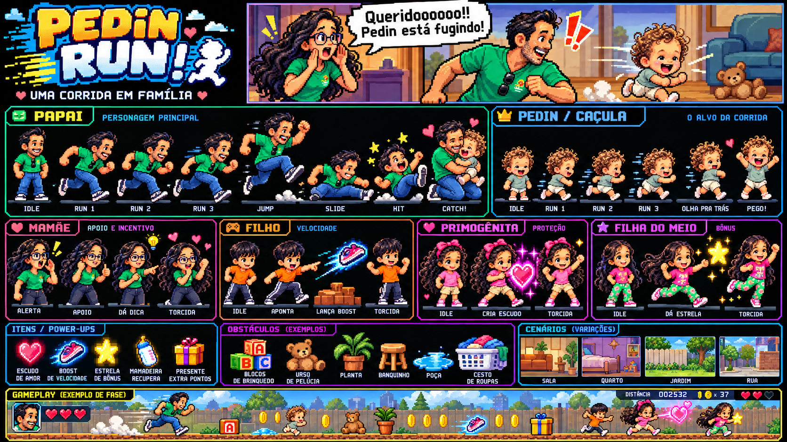

# Pedin Run! — Style guide oficial

**Status: norma visual do projeto.** Este guia vale para tudo que aparece ao jogador: jogo, HUD, abertura, menus, carregamento, pausa, resultado, configurações, controles de toque e página que contém o canvas. Em caso de divergência com decisões visuais anteriores, este documento prevalece. As regras de gameplay continuam nos documentos de design.



A referência acima é a fonte de verdade. Os assets gerados e a interface implementada são versões de trabalho, não novas referências aprovadas. Um componente não está aprovado simplesmente porque funciona ou porque usa uma cor deste guia.

## 1. Identidade: uma aventura de família em pixel art

O visual combina personagens expressivos, contornos escuros, cores vivas, cenários domésticos acolhedores e interface de videogame em pixels. A sensação de velocidade vem das poses, da passada, do cenário e dos pequenos efeitos de movimento. O afeto aparece nas expressões, nos corações e na interação entre os personagens.

Na prancha, observar cinco famílias visuais:

| Região da referência | O que estabelece |
| --- | --- |
| Logo no canto superior esquerdo | Letras desenhadas, grandes, inclinadas, amarelo/laranja e branco/azul; contorno e sombra em degraus |
| Cena de abertura no topo | Expressões exageradas, ambiente quente, balão branco com borda preta pixelada |
| Personagens no centro | Identidade de cada membro da família, proporção cartunesca, volume construído em grupos de pixels |
| Itens e obstáculos | Silhuetas claras, cores fortes e objetos reconhecíveis mesmo pequenos |
| Faixa de gameplay inferior | Cenário ocupando a tela, HUD compacto sobre a cena, retrato, corações e contadores em pixels |

Os painéis centrais da prancha organizam a apresentação dos assets. Eles não devem virar uma grade de cartões sobre a pista. A faixa inferior é a referência específica para a composição do gameplay.

## 2. Linguagem obrigatória e desvios proibidos

**Obrigatório:** pixel art consistente; bordas em degraus; contraste alto; sombras duras; brilho desenhado em pixels; ícones próprios; texto com desenho bitmap; cenas e personagens ocupando o protagonismo.

**Não usar:** glassmorphism, `backdrop-filter`, painéis translúcidos com blur, cartões de aplicativo com cantos arredondados suaves, gradientes radiais decorativos na página, sombras desfocadas, fontes modernas de dashboard no HUD, emojis como assets, símbolos Unicode como substitutos de coração/moeda/controles, ícones de bibliotecas com traço vetorial arredondado, personagens 3D ou ilustração vetorial lisa.

Não usar uma interface bege/verde dessaturada como identidade geral. O verde da camiseta do papai não transforma todos os menus em verde. A interface combina preto/azul muito escuro, ciano, branco, amarelo e acentos rosa, conforme a referência.

**Exceção de técnica, não de aparência:** HTML semântico e CSS são permitidos para acessibilidade. Precisam reproduzir a mesma linguagem pixelada do canvas. Foco, controles e diálogos também fazem parte da direção de arte.

## 3. Paleta funcional

Os valores abaixo são aproximações normalizadas da referência para padronizar a implementação, não uma alegação de extração exata dos pixels. A relação entre as cores e a leitura da referência prevalecem sobre usar um hexadecimal isolado.

| Token | Cor | Uso |
| --- | --- | --- |
| `ink` | `#080B12` | Contornos, fundo dos painéis e sombras |
| `panel` | `#101C34` | Interior azul-escuro do HUD e dos menus |
| `panel-light` | `#1D3556` | Relevo interno de painéis |
| `cyan` | `#00CFFF` | Moldura principal e destaques de navegação |
| `blue` | `#1673D1` | Sombra azul do logo e profundidade de molduras |
| `white` | `#F8FAFF` | Texto principal, brilho e balões |
| `yellow` | `#FFE34A` | Logo, moeda, seleção e ação principal |
| `orange` | `#FF9B25` | Sombra do amarelo, boost e identidade do filhão |
| `pink` | `#FF64A8` | Corações, afeto e proteção |
| `magenta` | `#E52CDA` | Energia do escudo e detalhes das meninas |
| `green` | `#20BE65` | Identidade do papai e detalhes da mamãe |
| `red` | `#F0445A` | Dano e alertas breves |

Pele, cabelo, madeira, tecidos e vegetação usam rampas próprias de pixel art. Não recolorir todos os sprites com a paleta da interface. Sombreamento de assets pode usar várias tonalidades; evitar gradientes suaves adicionados por CSS sobre os desenhos.

Tokens para código: [style-tokens.json](style-tokens.json). Não substituir o tema atual apenas trocando cores: geometria, tipografia e composição também precisam mudar.

## 4. Pixels, escala e acabamento

- Canvas lógico: **960 × 540**, proporção 16:9. Não deformar a cena para preencher o dispositivo.
- Interface construída em grade de 2 px lógicos. Espaçamentos preferenciais: 4, 8, 12, 16 e 24 px.
- Contornos principais: 2 px; moldura composta: linha escura externa + linha colorida + sombra interna. Em arte menor, usar contorno de 1 px coerente com o sprite.
- Cantos chanfrados em degraus de 2–4 px. `border-radius` suave não é um atalho aceitável.
- Sombras: deslocamento de 2–4 px, cor sólida, sem blur. Brilhos mágicos são sequências de pixels desenhados nos assets.
- Sprites com nearest-neighbor, `pixelArt: true` e coordenadas arredondadas na apresentação. A física pode usar decimais.
- Preferir escala inteira. Em telas menores, preservar proporção e legibilidade; conferir no tamanho real, não apenas em zoom.
- Nunca misturar um ícone grosseiro de 8 × 8 com um retrato muito detalhado sem ajustar a escala visual entre eles.

## 5. Tipografia e logo

**Logo:** asset desenhado conforme a referência. “PEDIN” amarelo com sombra laranja; “RUN!” branco com sombra azul/ciano; contornos escuros, inclinação e rastros pixelados. Não aprovar texto HTML em negrito/itálico com `text-shadow` como versão final do logo.

**HUD e botões:** fonte bitmap local, licenciada, de traço quadrado e largura regular, com números tabulares. Títulos curtos em caixa alta. A fonte deve incluir `Á À Â Ã É Ê Í Ó Ô Õ Ú Ç`, sinais, números e pontuação em português. A seleção do arquivo da fonte ainda está pendente; a fonte system-ui atual não está aprovada.

**Diálogo:** texto bitmap escuro dentro de balão branco, com contorno preto em degraus. Quebras curtas, expressão oral e leitura imediata. Evitar caixa alta em parágrafos longos.

| Elemento | Tamanho inicial lógico |
| --- | --- |
| Título de painel | 24 px |
| Botão principal | 16 px |
| Número do HUD | 18 px |
| Rótulo do HUD | 12 px |
| Diálogo e instruções | 16 px |

São parâmetros iniciais para a fonte efetivamente escolhida. Ajustar em múltiplos compatíveis com seu bitmap. Texto essencial deve continuar legível no dispositivo final; não reduzir uma interface desktop inteira até ficar microscópica.

## 6. HUD obrigatório

O HUD atual deve ser redesenhado. A referência é a **faixa de gameplay na parte inferior da imagem**.

### Composição

```text
┌ retrato do papai ┬ ♥ ♥ ♥ ┐               DISTÂNCIA 000000   [moeda] × 00   [pausa]
└─────────────────┴───────┘
                      [papai] → 18 m → [Pedin]    [relógio] 90 s

                     CENÁRIO E PISTA LIVRES

[deslizar — somente quando necessário]                  [pular — toque]
```

O esquema define posição e hierarquia; não serve como arte final. Usar um único conjunto de vidas. A referência mostra variações de apresentação: não duplicar corações em dois lugares.

- **Retrato:** recorte de rosto/busto do papai em moldura azul/ciano pixelada. Não encolher um sprite de corpo inteiro para ocupar esse espaço.
- **Vida:** três sprites de coração rosa/vermelho, com brilho claro, borda escura e estado vazio próprio. Nunca usar `♥`/`♡` do sistema como desenho final.
- **Distância:** rótulo pequeno e número branco tabular com seis dígitos. A unidade aparece claramente nas instruções ou no contador. Não aparentar precisão inexistente.
- **Moedas:** ícone de moeda da mesma família visual dos coletáveis, seguido de `×` e contagem. Não usar um círculo amarelo genérico.
- **Aproximação:** indicador secundário com os dois personagens e separação em metros. Sem barra de progresso com aparência de dashboard. Não ocultar distância mínima de captura das instruções.
- **Tempo:** contador secundário com ícone pixelado de relógio; legível sem competir com vida e obstáculos.
- **Buffs:** ícone do escudo ou tênis + tempo restante em pequena placa pixelada abaixo do HUD. Aparecem apenas quando ativos.
- **Pausa:** botão quadrado com moldura pixelada e ícone próprio. Área de interação maior que o desenho quando necessário.

Margem de segurança inicial: 12 px lógicos. O HUD primário deve ficar concentrado nos primeiros 64–72 px da cena. Se não couber no celular, redistribuir os indicadores secundários; não cobrir a pista nem reduzir o texto até ficar ilegível.

## 7. Componentes e telas

| Componente | Regra visual |
| --- | --- |
| Painel | Fundo preto/azul escuro, moldura ciano em degraus, sombra dura |
| Botão principal | Superfície amarela, sombra laranja/escura, texto escuro bitmap, contorno pixelado |
| Botão secundário | Superfície azul-escura, moldura ciano, texto branco |
| Selecionado/foco | Marcador ou segunda borda amarela pixelada; não depender só da cor |
| Pressionado | Deslocamento de 2 px e redução da sombra; sem elasticidade de aplicativo |
| Desabilitado | Rampa azul/cinza escura, texto ainda legível; sem depender apenas de opacidade |
| Slider | Trilho segmentado e cursor quadrado em pixels; manter input acessível |
| Checkbox | Caixa quadrada com marcador pixelado; label clicável |
| Balão da mamãe | Branco com borda preta em degraus, pequena cauda apontando para o retrato/personagem |

**Menu:** logo oficial, cena da família, “JOGAR”, “COMO JOGAR” e “CONFIGURAÇÕES”. Remover a composição de landing page: slogan editorial fora do jogo, badges de marketing, cartões de benefícios, cabeçalho com marca alternativa e rodapé corporativo.

**Carregamento:** logo ou personagem da família, contador e barra segmentada em pixels. Erro e “TENTAR NOVAMENTE” usam a mesma família de painel/botão.

**Pausa/configurações:** painel pixelado sobre a cena escurecida por cor sólida sem blur. “CONTINUAR”, “RECOMEÇAR”, “MENU”. A caixa de diálogo nativa precisa de estilização completa, inclusive foco.

**Vitória:** abraço como protagonista, corações pixelados, pontuação e botão “JOGAR DE NOVO”. A referência do papai abraçando o Pedin deve orientar o asset específico da captura. Comemoração com os dois separados é provisória.

**Derrota:** tropeço leve ou Pedin junto da mamãe, convite para tentar outra vez. Nada de violência ou expressão de sofrimento real.

**Toque:** controles quadrados ou chanfrados, setas pixeladas e rótulo curto. Área mínima de 56 × 56 CSS px, safe areas e resposta visual ao toque. Em retrato, manter a cena 16:9 e reservar espaço de controle fora da pista se necessário. Não exibir um painel moderno destoante embaixo do jogo.

## 8. Personagens e animações

| Personagem | Traços que não podem mudar |
| --- | --- |
| Papai | Cabelo preto, barba curta, camiseta verde, jeans azul, tênis escuro/claro, óculos pendurados na gola |
| Pedin | Cachos castanho-dourados, camiseta clara verde-acinzentada, fralda branca, pés descalços, proporção de bebê |
| Mamãe | Cabelo longo escuro, óculos azuis, camiseta verde, calça escura |
| Filhão | Cabelo escuro curto, camiseta laranja, calça escura, tênis |
| Primogênita | Cabelo cacheado escuro, laço rosa, camiseta rosa, short claro, tênis rosa |
| Filha do meio | Cabelo longo escuro, camiseta rosa, calça verde estampada, tênis rosa |

Preservar proporções, contornos, iluminação e densidade de pixels entre todos os estados. Não mudar idade aparente, rosto, roupas ou escala entre corrida e pulo.

Corrida exige alternância real das pernas, braços em oposição, contato, compressão, passagem e suspensão. Mais quadros semelhantes não garantem fluidez. Usar os 16 quadros atuais como material em revisão, com 20 fps como ponto de partida. Conferir fechamento do ciclo, trajetória dos pés e estabilidade do tronco. O chão não pode parecer deslizar sob um pé plantado por tempo excessivo.

Recorte, pivô e escala são parte do asset. Atlas deve preservar pés, cabelo e braços, com posição estável entre quadros. Preservar o deslocamento vertical intencional da passada; não eliminar a fase aérea ao alinhar todas as silhuetas pela borda inferior. Usar uma linha de chão comum e offsets por fase quando necessário.

## 9. Cenários, objetos e efeitos

Sala, quarto, jardim e rua seguem a mesma pixel art da referência: perspectiva lateral coerente, chão horizontal, contornos definidos e luz quente. Fundo menos contrastado que obstáculos/personagens. A cena deve continuar legível em movimento.

Decoração não pode parecer um obstáculo jogável. Cada item mantém sua silhueta: coração de proteção, tênis de velocidade, estrela amarela, mamadeira e presente. Usar o próprio objeto no HUD, adaptado à escala da interface.

Poeira, estrelas, rastros e corações devem ser sprites ou formas compostas de pixels, com vida curta e sem esconder a ação. Não usar círculos vetoriais suaves como poeira final. Evitar glow genérico aplicado sobre todo o canvas. Redução de movimento desliga tremor e efeitos decorativos, mantendo sinais essenciais de colisão e coleta.

## 10. Migração obrigatória da interface atual

| Implementação atual | Substituição exigida |
| --- | --- |
| Fundo radial verde/cinza da página | Fundo da cena ou moldura externa preta/azul da referência |
| Cabeçalho, slogan e cards externos | Composição de menu de videogame dentro da identidade do jogo |
| Logo feito com texto e ícone “P” alternativo | Logo pixel art conforme a referência |
| `system-ui` no HUD e nos botões | Fonte bitmap local aprovada com português |
| Painéis arredondados/translúcidos | Placas de pixels com contorno ciano e sombra dura |
| `.scrim` e diálogos com blur | Escurecimento simples e painel pixelado |
| Corações, moeda, pausa e setas Unicode | Sprites de UI próprios e estados correspondentes |
| Barra moderna de aproximação | Indicador secundário de perseguição com personagens |
| Miniatura da mamãe usando corpo inteiro | Retrato próprio e balão branco pixelado |
| Poeira em círculos de Graphics | Partículas pixeladas coerentes com a referência |
| Prévia por grade aproximada | Prévia usando os mesmos atlas e pivôs da versão jogável |

Ordem de aplicação: **fonte e kit de UI → HUD → menu e logo → pausa/configurações/resultado → controles móveis → acabamento dos assets e efeitos**. Não declarar a migração concluída após alterar apenas a paleta.

## 11. Critério de aprovação visual

Uma entrega visual só é aprovada quando:

- Existe captura real do jogo em desktop e celular, comparada lado a lado com a referência.
- Todos os elementos parecem pertencer ao mesmo jogo, inclusive carregamento, foco e controles de toque.
- HUD tem retrato, corações e contadores legíveis, com a pista livre.
- Não há fonte de dashboard, emoji, blur, cartão arredondado suave ou marca alternativa visível.
- Sprites não cortam membros, não variam de identidade e não saltam de escala ao trocar de estado.
- Animações foram vistas em loop, em velocidade normal, com atenção ao ponto de repetição.
- Português, contraste, foco por teclado, safe areas e redução de movimento foram conferidos.

Build e testes de lógica não comprovam fidelidade visual. Se não houver acesso ao navegador, registrar **“validação visual pendente”**, nunca “visual aprovado”.

## 12. Proporções dos objetos na cena

Implementação compartilhada em `src/game/data/prop-sizes.json`. Cada desenho usa **um único fator de escala**, calculado para caber nos limites abaixo. A dimensão final pode ser menor em um eixo para preservar a proporção do atlas; nunca forçar largura e altura independentemente.

| Objeto | Limite lógico (largura × altura) | Relação desejada |
| --- | --- | --- |
| Blocos | 56 × 52 | Brinquedo abaixo da altura do Pedin |
| Urso | 64 × 64 | Próximo da altura do Pedin, menor que o papai |
| Banquinho | 106 × 88 | Móvel baixo com passagem para deslizar |
| Planta | 68 × 72 | Objeto intermediário; expansão |
| Poça | 72 × 32 | Silhueta baixa; expansão |
| Cesto | 64 × 52 | Obstáculo baixo; expansão |
| Moeda | 20 × 26 | Menor coletável |
| Escudo | 44 × 44 | Ícone de proteção menor que o Pedin |
| Boost | 48 × 44 | Tênis com rastro preservado |
| Estrela | 36 × 36 | Bônus pequeno; expansão |
| Mamadeira | 26 × 40 | Forma vertical preservada; expansão |
| Presente | 44 × 44 | Bônus médio; expansão |

A colisão do banquinho cobre apenas o tampo; os brinquedos usam áreas internas à silhueta. A coleta considera o centro do item, sem fazer todo o brilho externo contar como contato. A distância dos rótulos acompanha a altura real de cada objeto.

Prévia comparativa: execute `npm run dev` e abra `/art/proporcoes.html`. Ela reutiliza os atlas, escalas dos personagens e configuração de objetos do jogo, e permite exibir as colisões dos obstáculos ativos. Os itens reservados para expansão aparecem apenas na comparação.

Verificação: testes de física atualizados com as dimensões reais passaram para pulo nas três velocidades e passagem sob o banquinho. **Validação visual no navegador pendente**; esses testes não aprovam a aparência.

## 13. Registro da migração

### Etapa 1 — kit de UI e HUD (2026-10-28)

**Fonte provisória:** substituída na etapa 2 (ver abaixo). A Pixelify Sans testada aqui confundia `G`/`B`, `5`/`S` e `Z`/`2`.

**Kit de UI em código** (`src/ui/pixel-art.ts`): mapas de pixels únicos para coração cheio/vazio, relógio, pausa, setas, chevron e cauda do balão, e uma moldura de 9 fatias (contorno escuro, linha colorida, relevo, sombra e cantos em degraus) com variantes ciano, rosa, laranja, amarela, botão principal e balão. As cores vêm de `docs/style-tokens.json`. O mesmo mapa vira SVG/`border-image` no HTML e `paintFrame`/`paintPixels` no canvas do Phaser. Os ícones são provisórios até existir um atlas de UI desenhado.

**HUD** (`src/ui/hud.ts`, `src/ui/hud.css`), conforme a seção 6:

- Retrato do papai recortado do rosto/busto no atlas, em moldura ciano, com três corações pixelados de estado cheio/vazio.
- `DISTÂNCIA` com seis dígitos e unidade `m`; moeda do atlas de itens seguida de `×` e contagem; botão de pausa quadrado, com foco amarelo, deslocamento de 2 px ao pressionar e área de toque de no mínimo 56 px CSS.
- Indicador secundário com rostos do papai e do Pedin e a separação em metros, sem barra de progresso; tempo com relógio pixelado.
- Buffs em placas rosa (escudo) e laranja (boost) com o próprio item e segundos inteiros, só quando ativos.
- Balão da mamãe: retrato próprio (rosto recortado) e balão branco com borda em degraus e cauda.
- No canvas: placas `PULE`/`DESLIZE` com a mesma moldura e corações da captura como sprites; não há mais `system-ui` nem símbolos Unicode no jogo.
- Controles de toque: botões chanfrados com setas pixeladas, `DESLIZE` secundário e `PULE` principal amarelo, safe areas e mínimo de 56 px CSS. Em celular em retrato, os controles ficam numa faixa abaixo da cena 16:9.

**Escala:** o HUD é desenhado em pixels lógicos e acompanha o canvas sem passar da escala da cena, sempre com número inteiro de pixels do dispositivo por pixel lógico. O mínimo é cerca de 0,625; abaixo disso a camada fica logicamente mais estreita e os indicadores secundários se centralizam. No desktop padrão (canvas com ~1206 px), o HUD fica em escala 1.

**Verificação:** capturas reais no Chromium headless em 1440 × 1100, 390 × 844 e 844 × 390 (DPR 3), com corações perdidos, buffs, balão, dica de deslize, foco da pausa e captura. Testes de lógica, build e o roteiro `npm run test:e2e` passaram. **Validação visual pendente:** comparação lado a lado com a referência por uma pessoa, aparelhos reais (Android/iOS), Firefox/Safari e aprovação da fonte. No retrato, o HUD ainda ocupa cerca de um terço da altura da cena, porque o canvas tem só ~200 px de altura.

**Fora desta etapa:** menu, logo, carregamento, pausa, configurações, resultado, moldura da página (`game-top`/`game-bottom`, que ainda usa `♥` e `system-ui`), anel do escudo e poeira.

### Etapa 2 — página, menu, abertura, telas e família (2026-10-28)

**Fonte provisória:** Jersey 10 (SIL OFL 1.1), local via `@fontsource/jersey-10` 5.3.0, peso único, com os acentos do português. Comparada lado a lado com Pixelify Sans, Silkscreen, Press Start 2P e VT323, foi a mais próxima da referência e a mais legível (G, 5, Ç, Õ). A grade é de 10 px: os tamanhos foram ajustados para 15 (rótulo), 20 (número, botão, diálogo) e 30 (título). `font-synthesis:none` evita negrito falso. Aprovação final pendente.

**Página:** removidos cabeçalho, slogan, recorde externo, faixas de status, cartões de ajuda e rodapé. A página é só o gabinete do jogo: fundo `ink` sólido, moldura ciano em degraus e sombra azul dura. Som e tela cheia passaram para o menu; configurações também ficam na pausa.

**Logo:** desenhado por código em `src/ui/logo.ts`, com letras blocadas próprias, inclinação em degraus, PEDIN amarelo com sombra laranja, RUN! branco com sombra azul e faixa ciano, contorno escuro e rastros de velocidade. Continua provisório até existir um asset desenhado.

**Menu (`ready`):** a família inteira na sala, se preparando: mamãe na frente, papai, Pedin e, ao fundo, filhão, primogênita e filha do meio. À direita ficam o logo, “UMA CORRIDA EM FAMÍLIA”, JOGAR, COMO JOGAR e CONFIGURAÇÕES. No canto ficam o recorde, o som e a tela cheia. Sem texto de apresentação.

**Abertura (`intro`, novo estado do domínio):** ao apertar JOGAR, a mamãe troca para a linha “alerta” (mãos no rosto) e o balão branco grita “Queridooooo!! O Pedin está fugindo!!”. O papai se agacha, pronto para correr, e o Pedin dispara. Depois de 2,8 s a corrida começa sozinha; tecla, toque ou Enter pulam a cena. A mamãe e os irmãos ficam para trás e saem com o chão. RECOMEÇAR e JOGAR DE NOVO vão direto à corrida.

**Irmãos na corrida:** cada um aparece no fundo da sala, faz a ação da própria prancha e deixa o item à frente: filhão → boost, primogênita → escudo, filha do meio → estrela (novo coletável, +50 pontos, no alto, pede pulo). Depois, o irmão comemora. O balão da mamãe credita cada um.

**Vitória:** papai e Pedin comemoram com corações; a mamãe aparece torcendo e os irmãos entram correndo para torcer junto. O painel de resultado fica à direita para manter a família visível. Mostra pontos, moedas, estrelas, recorde e o selo de novo recorde. O asset específico do abraço continua pendente.

**Pausa, configurações e instruções:** painéis pixelados sobre escurecimento sólido, sem blur. Slider com trilho segmentado e cursor quadrado, checkbox quadrado com marcação pixelada, teclas em placas e foco amarelo. As instruções explicam o papel de cada irmão.

**Carregamento:** logo, contador e barra de 12 segmentos; o erro usa o mesmo painel e o botão TENTAR NOVAMENTE.

**Verificação:** capturas no Chromium em 1440 × 900, 390 × 844 e 844 × 390 (DPR 2) de carregamento, menu, abertura, corrida com os três irmãos, vitória, pausa e configurações. Testes (23), build e `npm run test:e2e`, agora passando pela abertura, passaram. **Validação visual pendente** em aparelhos reais e na comparação humana com a referência. Abaixo da escala 0,625, o HUD aceita pixel fracionado para manter o texto legível.

**Ainda provisório:** logo e ícones feitos em código, ausência de pose própria de abraço, poeira em círculos, anel do escudo vetorial e um único cenário (sala).
